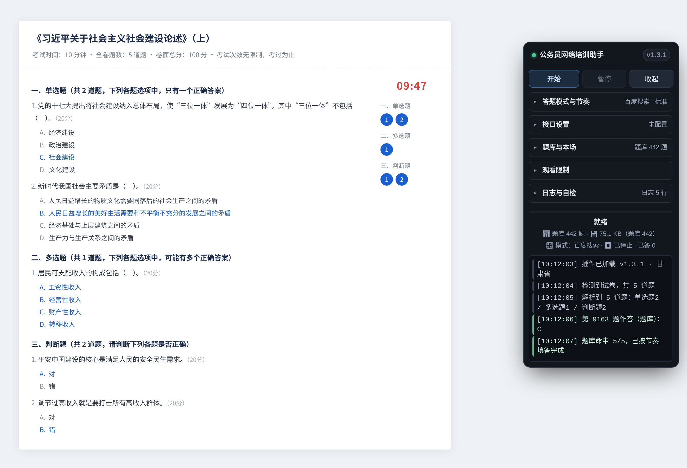

# 公务员网络培训助手

面向各地「公务员网络培训」平台的 Tampermonkey 用户脚本：自动作答试卷、解除「切窗口就暂停」的播放限制、本地题库积累与导入导出。


单文件、无构建、无第三方依赖、无遥测。可在油猴里直接读完。



<sub>面板叠在试卷页上：5 道题已全部作答，题库 442 条。图为离线复刻，未使用真实账号。</sub>

## 支持范围

| 省份 | 状态 | 说明 |
| --- | --- | --- |
| 甘肃省 | 已适配 | `gwypx.gsdj.gov.cn`，题库 442 条 |
| 其他省份 | 可扩展 | 同构平台改 `SITES` 一段即可；非已知域名会走 DOM 探测，多数情况无需改动 |

新增省份的方法见 [docs/ARCHITECTURE.md](docs/ARCHITECTURE.md)，核心就是在 `SITES` 数组里加一项：

```js
{
  id: 'example',
  label: '某省',
  hosts: ['px.example.gov.cn'],
  playerPath: /\/videoPlay\//,
  listPath: /\/getGradeCourseList/,
  sel: BASE_SEL,          // 结构一致就复用，不一致时覆盖需要的字段
}
```

同时要在脚本头补该省份的 `@match` 与 `@connect`，否则脚本不会注入。

## 功能

| 场景 | 能力 |
| --- | --- |
| 试卷页 | 解析单选 / 多选 / 判断，题库匹配后自动填答，逐题回读校验 |
| 交卷 | 默认不自动交卷；开启后仅在全部题目都有答案时才提交 |
| 播放页 | 切窗口、开别的软件、放副屏都不再暂停计时，意外暂停自动续播 |
| 题库 | 内置 442 条答案；支持 JSON / CSV 导入导出、补全、清空 |
| 面板 | Shadow DOM 隔离，胶囊按钮开关，可拖动、分组折叠，含日志与诊断包 |

面板快捷键：`Alt+A` 开始作答、`Alt+H` 收起、`Alt+L` 清空日志。

## 安装

1. 浏览器安装 [Tampermonkey](https://www.tampermonkey.net/)（Violentmonkey 亦可）
2. 二选一装脚本：
   - **直接下载**（推荐）：[`最新 Release 附件`](https://github.com/Gnayiel/civil-servant-training-assistant/releases/latest/download/civil-servant-training-assistant.user.js) — 拖进浏览器窗口即可（不写死版本号，永远指向最新）
   - **手动粘贴**：打开油猴面板 → 添加新脚本 → 粘贴 [`civil-servant-training-assistant.user.js`](civil-servant-training-assistant.user.js) 全文
3. 登录培训网站，页面右下角出现「公务员网络培训助手」面板即生效

脚本声明了 `@noframes` 与顶层窗口判定，不会在 iframe 里重复注入。域名不在适配表里且页面看不出是培训平台时，脚本静默退出，不打扰。

### 关于自动更新

脚本的 `@updateURL` 指向 jsDelivr 而不是 `raw.githubusercontent.com`，因为后者在中国大陆经常不可达——用它做更新地址时油猴的版本检查会静默失败，永远收不到新版本。

代价是 jsDelivr 对分支有 12 小时缓存，**新版本最多延迟 12 小时才提示**。想立刻升级就从上面的 Release 链接重装一次。

## 使用

**答题。** 打开任意课程的「考试」，面板会自动检测到试卷并开始作答（可用「自动作答」按钮关掉）。作答完成后核对一遍，再手动交卷，或点开「自动交卷」。

**观看。** 打开课程播放页即生效，无需操作。视频仍按 1 倍速真实播放。

**题库。** 交卷通过后，本场答案会被标记为已验证；未通过不写库。换设备时用「导出 JSON」带走，在新环境导入。

## 文档

| 文档 | 面向 | 内容 |
| --- | --- | --- |
| [docs/ARCHITECTURE.md](docs/ARCHITECTURE.md) | 维护者 | 多省份适配、DOM 地图、答案数据流、反作弊拦截点 |
| [docs/DEVELOPMENT.md](docs/DEVELOPMENT.md) | 贡献者 | 命令、五层测试、fixture 维护、配图、排查表 |
| [docs/RELEASING.md](docs/RELEASING.md) | 发版维护者 | 版本号副本、发版流程、四道门禁、失败恢复、回滚 |
| [docs/REPOSITORY_SETTINGS.md](docs/REPOSITORY_SETTINGS.md) | 仓库管理员 | Actions 权限、rulesets、Security（均为建议，需网页确认） |
| [docs/IMAGE_PIPELINE.md](docs/IMAGE_PIPELINE.md) | 维护者 | 三张配图的生成方式与数字同步 |
| [CONTRIBUTING.md](CONTRIBUTING.md) | 贡献者 | 改哪一层、不接受的方向 |
| [SUPPORT.md](SUPPORT.md) | 使用者 | 求助渠道、要附带的材料 |
| [data/README.md](data/README.md) | 题库维护者 | 快照字段、覆盖率、来源与边界 |
| [docs/README.md](docs/README.md) | 所有人 | 文档索引与维护约定 |

## 边界

这条线是这个项目最先要说清楚的事。

平台弹窗列了三类会停止计时的行为，但代码里**只实现了一条**：`window.onblur`。所谓「其它软件遮挡页面」「同时打开多个播放页」没有任何检测代码。脚本拦掉这一条，于是切窗口不再中断播放。

同时必须说明：进度上报接口 `POST /gansu-spcrm/rest/AddCourse` 没有签名校验，技术上可以直接上报一个很大的时长把学分刷满。**脚本不这么做**，也不接受实现这类功能的 PR：

- 不伪造 `Sessiontime`、不倍速、不跳播
- 不绕过登录验证码
- 不做多账号批量刷课
- 不采集、不上传任何数据

解除失焦暂停是改善使用体验，伪造学时是骗取培训记录——前者是工具，后者不是。视频始终按原速真实播放，上报的进度与时长都来自真实播放状态。

## 数据

题库来自甘肃省本培训班 94 门课实际下发的 470 道题，去重后 469 道，其中 **442 道**（94.2%）已人工判定答案并内嵌进脚本。

剩余 27 道是甘肃地方性数据题（如马跑泉灌溉井人口、庄浪梯田土方量）和几道题干本身有缺陷的题，未收录；遇到时脚本跳过并记日志，不猜。

其他省份的题需要自行采集补充，方法见 [data/README.md](data/README.md)。

## 平台结构

维护者需要知道的三个坑（完整 DOM 图见 [docs/ARCHITECTURE.md](docs/ARCHITECTURE.md)）：

1. **多选题的 `dl` 类名也是 `danxuan`**，题型只能按控件类型判定
2. **题号在每个题型块内从 1 重来**，唯一键取 `name` 里的数字（`danxuan9163` → `9163`）
3. **页头「全卷题数：10道题」是模板写死的**，实际每卷 5 题，只能数 DOM

## 开发

```bash
node tools/ci.mjs            # 语法 + 文档 + 数据 + 自检 + 工作流 + 页面冒烟
node tools/ci.mjs --strict   # 要求必须有浏览器
```

不需要 `npm install`。测试分五层，详见 [docs/DEVELOPMENT.md](docs/DEVELOPMENT.md)；贡献方式见 [CONTRIBUTING.md](CONTRIBUTING.md)。

```
civil-servant-training-assistant.user.js   主脚本（安装这个）
data/                                      题库快照与说明
docs/                                      架构、开发文档与配图
tests/                                     自检与页面冒烟（含真实结构 fixture）
tools/                                     检查、CI、题库同步、仓库初始化
```

## 常见问题

**面板没出现？** 确认脚本已启用、页面域名在 `SITES` 里（或页面结构能被识别）、且不是从 iframe 里打开的。

**状态条显示「通用适配」？** 当前域名不在适配表内，脚本靠 DOM 探测在工作。若功能异常，用面板导出诊断包提 issue。

**某题显示「无可用答案」？** 该题不在内置题库里。自行作答即可，脚本不会替你猜。

**交卷后题库没更新？** 只有「通过」才会回写。平台不给逐题对错，未通过时无法判断哪题错了。

**怎么报问题最有效？** 面板「日志」组里点「诊断包」，生成的 JSON 含版本、适配层命中数、题库计数与脱敏日志，不含 token 与个人信息。

**会被判定异常吗？** 脚本只在你打开的页面上操作 DOM、调用平台自己的接口，不并发、不伪造数据。但平台条款由平台解释，风险自负。

## 许可证

[MIT](LICENSE)。题目与课程内容的著作权归原平台及原作者，本项目仅收录题干与选项文本用于本地作答辅助；权利人如有异议，开 issue 即移除。

## 免责

仅供个人学习辅助。请遵守平台用户协议与所在单位的培训纪律。
