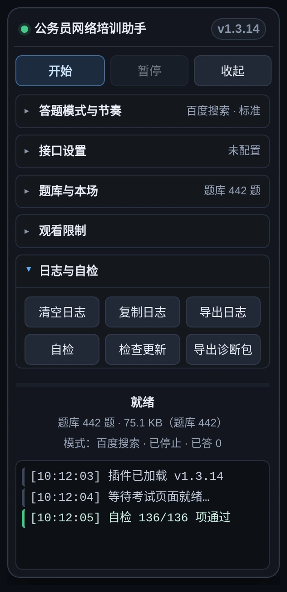

# 公务员网络培训助手

面向各地「公务员网络培训」平台的 Tampermonkey 用户脚本：自动作答试卷、解除「切窗口就暂停」的播放限制、本地题库积累与导入导出。


单文件、无构建、无第三方依赖、无遥测。可在油猴里直接读完。



<sub>面板特写，与「法宣在线助手」同一套界面。图为离线渲染，未使用真实账号。</sub>

## 支持范围

| 省份 | 状态 | 说明 |
| --- | --- | --- |
| 甘肃省 | 已适配 | `gwypx.gsdj.gov.cn`，题库 442 条 |
| 其他省份 | 需自行改脚本 | **必须**在脚本头加该省份的 `@match`（否则脚本根本不会注入），结构差异再由 DOM 探测兜 |

> **不要被「通用适配」误导**：脚本里确实有一套 DOM 探测（`FALLBACK_SITE` +
> `looksLikePlatform()`），域名不在适配表时会靠它判断页面是不是培训平台。
> 但**注入范围由 `@match` 决定**，默认只写了 `gwypx.gsdj.gov.cn` ——
> 对其他任何站点，脚本压根不会运行，那套探测代码也永远不会执行。
> 想在其他省份用，必须自己改脚本头的 `@match`（见下文步骤）。

新增省份的方法见 [docs/ARCHITECTURE.md](docs/ARCHITECTURE.md)，核心就是在 `SITES` 数组里加一项：

```js
{
  id: 'example',
  label: '某省',
  hosts: ['px.example.gov.cn'],
  playerPath: /\/videoPlay\//,
  listPath: /\/getGradeCourseList/,
  sel: BASE_SEL,          // 结构一致就复用，不一致时覆盖需要的字段
}
```

**同时必须在脚本头补该省份的 `@match` 与 `@connect`**，否则脚本不会注入（这是硬门槛，
不是可选项）：

```js
// @match        https://px.example.gov.cn/*
// @connect      px.example.gov.cn
```

补充说明：`@connect` 只影响跨域请求。答题本身走页面同源请求，不加也能作答；
但播放页的解锁逻辑与「检查更新」需要它。稳妥起见两个都加。

## 功能

| 场景 | 能力 |
| --- | --- |
| 试卷页 | 解析单选 / 多选 / 判断，题库匹配后逐题填答并回读校验 |
| 查答案 | 题库优先；未收录时**先百度、最后 AI**（双通道交叉验证） |
| 交卷 | 默认手动；开启自动交卷后仅在全部题目都有答案时才提交 |
| 播放页 | 切窗口、开别的软件、放副屏都不再暂停计时，意外暂停自动续播 |
| 题库 | 内置 442 条答案；JSON / CSV 导入导出、补全、清空、争议题导出 |
| 面板 | 与「法宣在线助手」同一套界面：分类折叠、摘要、两行统计、按级别着色日志 |

### 与「法宣在线助手」的关系

本脚本是 `faxuanyun-legal-exam-assistant` 的同族改版：**界面、分类名称、按钮文案、
统计行格式完全一致**，功能实现按本平台页面重新适配，并多一个「观看限制」分类
（本平台多了播放计时限制，法宣那边没有这个页面）。

| 位置 | 两个脚本一致 | 本脚本多出来的 |
| --- | --- | --- |
| 顶栏 | 开始/停止 · 暂停/继续 · 收起 | — |
| 分类 | 答题模式与节奏 · 接口设置 · 题库与本场 · 日志与自检 | **观看限制**（解除失焦暂停 / 意外续播 / 静音自动播放） |
| 模式 | AI智能 / 百度搜索，默认百度 | — |
| 题库 | 导出答案库（CSV+JSON）/ 导入 / 解析成绩 / 导出争议题 / 关闭页 / 清空本场 / 手动对账 | 补全内置 · 清空题库（内置 442 题的灌回与整库清空） |
| 统计 | `📊 题库 N 题 · 💾 x KB` / `🎛 模式 · 状态 · 已答` | 括号里少「错题 / 墓碑」两项（本脚本没有独立错题本） |

面板快捷键：`Alt+A` 开始作答、`Alt+H` 收起、`Alt+L` 清空日志。

## 安装

1. 浏览器安装 [Tampermonkey](https://www.tampermonkey.net/)（Violentmonkey 亦可）
2. 二选一装脚本：
   - **直接下载**（推荐）：[`最新 Release 附件`](https://github.com/Gnayiel/civil-servant-training-assistant/releases/latest/download/civil-servant-training-assistant.user.js) — 拖进浏览器窗口即可（不写死版本号，永远指向最新）
   - **手动粘贴**：打开油猴面板 → 添加新脚本 → 粘贴 [`civil-servant-training-assistant.user.js`](civil-servant-training-assistant.user.js) 全文
3. 登录培训网站，页面右下角出现「公务员网络培训助手」面板即生效

脚本声明了 `@noframes` 与顶层窗口判定，不会在 iframe 里重复注入。域名不在适配表里且页面看不出是培训平台时，脚本静默退出，不打扰。

### 关于自动更新

两层机制，互补：

- **油猴自带的更新检查**：读 `@updateURL`。指向 jsDelivr 而不是 `raw.githubusercontent.com`，因为后者在中国大陆经常不可达——用它做更新地址时版本检查会静默失败，永远收不到新版本。

  两个地址分工不同，都不能用 CDN 的分支指针：

  | 字段 | 指向 | 为什么 |
  | --- | --- | --- |
  | `@updateURL` | GitHub `releases/latest/download/…` | **移动指针**，用来发现新版本。随新 Release 立即改指向 |
  | `@downloadURL` | jsDelivr `@v{当前版本}` | **固定指针**，重装永远拿到与已装一致的版本；且下载留在国内可达的 CDN |

  为什么版本发现不能放 jsDelivr —— 两条路都实测过：

  | jsDelivr 写法 | 实测结果 |
  | --- | --- |
  | `@main`（分支） | `main` 已是 1.3.9 时，先后返回 **1.2.0** 和 **1.1.0**（不同边缘节点不一致）。响应头 `max-age=604800`（7 天）、`s-maxage=43200`（12 小时），分支缓存键不含查询串，加 `?t=` 也绕不过 |
  | `@latest`（最新 tag） | 也滞后：`v1.3.10` 已发布时仍停在 **1.3.8**（落后 3 版） |

  两者都做不了「发现新版本」，只能用于「按已知版本取文件」——所以 `@downloadURL`
  钉死 tag（tag URL 无缓存问题，实测打完 tag 立刻可读），而「读版本号」走 GitHub。
  只有这一小步依赖 github.com；真正的脚本下载仍在 jsDelivr。
- **面板里的「检查更新」**：并行查 `@updateURL` 与 GitHub Releases API，取两者较高版本。Releases API 不走 CDN，打完 tag 立刻反映，所以手动点一次就能拿到确定结论，不受 12 小时缓存影响。一个源不可达时日志会写明结果出自哪个源。

> 分支缓存各节点并不同步：实测同一时刻 `cdn.jsdelivr.net` 已是新版本，`fastly` / `gcore` / `testingcf` 仍停在旧版本。加 `?t=` 时间戳或 `Cache-Control: no-cache` 都绕不过——缓存键不含查询串。

## 使用

**答题。** 打开任意课程的「考试」，面板会自动检测到试卷并开始作答（可用「自动作答」按钮关掉）。作答完成后核对一遍，再手动交卷，或点开「自动交卷」。

**观看。** 打开课程播放页即生效，无需操作。视频仍按 1 倍速真实播放。

**题库。** 交卷通过后，本场答案会被标记为已验证；未通过不写库。换设备时用「导出 JSON」带走，在新环境导入。

## 文档

| 文档 | 面向 | 内容 |
| --- | --- | --- |
| [docs/ARCHITECTURE.md](docs/ARCHITECTURE.md) | 维护者 | 多省份适配、DOM 地图、答案数据流、反作弊拦截点 |
| [docs/DEVELOPMENT.md](docs/DEVELOPMENT.md) | 贡献者 | 命令、五层测试、fixture 维护、配图、排查表 |
| [docs/RELEASING.md](docs/RELEASING.md) | 发版维护者 | 版本号副本、发版流程、四道门禁、失败恢复、回滚 |
| [docs/REPOSITORY_SETTINGS.md](docs/REPOSITORY_SETTINGS.md) | 仓库管理员 | Actions 权限、rulesets、Security（均为建议，需网页确认） |
| [docs/IMAGE_PIPELINE.md](docs/IMAGE_PIPELINE.md) | 维护者 | 三张配图的生成方式与数字同步 |
| [CONTRIBUTING.md](CONTRIBUTING.md) | 贡献者 | 改哪一层、不接受的方向 |
| [SUPPORT.md](SUPPORT.md) | 使用者 | 求助渠道、要附带的材料 |
| [data/README.md](data/README.md) | 题库维护者 | 快照字段、覆盖率、来源与边界 |
| [docs/README.md](docs/README.md) | 所有人 | 文档索引与维护约定 |

## 边界

这条线是这个项目最先要说清楚的事。

平台弹窗列了三类会停止计时的行为，但代码里**只实现了一条**：`window.onblur`。所谓「其它软件遮挡页面」「同时打开多个播放页」没有任何检测代码。脚本拦掉这一条，于是切窗口不再中断播放。

同时必须说明：进度上报接口 `POST /gansu-spcrm/rest/AddCourse` 没有签名校验，技术上可以直接上报一个很大的时长把学分刷满。**脚本不这么做**，也不接受实现这类功能的 PR：

- 不伪造 `Sessiontime`、不倍速、不跳播
- 不绕过登录验证码
- 不做多账号批量刷课
- 不采集、不上传任何数据

解除失焦暂停是改善使用体验，伪造学时是骗取培训记录——前者是工具，后者不是。视频始终按原速真实播放，上报的进度与时长都来自真实播放状态。

## 数据

题库来自甘肃省本培训班 94 门课实际下发的 470 道题，去重后 469 道，其中 **442 道**（94.2%）已人工判定答案并内嵌进脚本。

剩余 27 道是甘肃地方性数据题（如马跑泉灌溉井人口、庄浪梯田土方量）和几道题干本身有缺陷的题，未收录；遇到时脚本跳过并记日志，不猜。

其他省份的题需要自行采集补充，方法见 [data/README.md](data/README.md)。

## 平台结构

维护者需要知道的三个坑（完整 DOM 图见 [docs/ARCHITECTURE.md](docs/ARCHITECTURE.md)）：

1. **多选题的 `dl` 类名也是 `danxuan`**，题型只能按控件类型判定
2. **题号在每个题型块内从 1 重来**，唯一键取 `name` 里的数字（`danxuan9163` → `9163`）
3. **页头「全卷题数：10道题」是模板写死的**，实际每卷 5 题，只能数 DOM

## 开发

```bash
node tools/ci.mjs            # 语法 + 文档 + 数据 + 自检 + 工作流 + 页面冒烟
node tools/ci.mjs --strict   # 要求必须有浏览器
```

不需要 `npm install`。测试分五层，详见 [docs/DEVELOPMENT.md](docs/DEVELOPMENT.md)；贡献方式见 [CONTRIBUTING.md](CONTRIBUTING.md)。

```
civil-servant-training-assistant.user.js   主脚本（安装这个）
data/                                      题库快照与说明
docs/                                      架构、开发文档与配图
tests/                                     自检与页面冒烟（含真实结构 fixture）
tools/                                     检查、CI、题库同步、仓库初始化
```

## 常见问题

**面板没出现？** 确认脚本已启用、页面域名在 `SITES` 里（或页面结构能被识别）、且不是从 iframe 里打开的。

**状态条显示「通用适配」？** 说明你已自行放宽了 `@match`，但域名不在 `SITES` 里，
脚本正靠 DOM 探测工作。此时题目区结构若与甘肃不同，可能出现「题干读不出来」的提示
（脚本会拒绝作答而不是瞎答）。功能异常时用面板导出诊断包提 issue。

**某题显示「无可用答案」？** 该题不在内置题库里。自行作答即可，脚本不会替你猜。

**交卷后题库没更新？** 只有「通过」才会回写。平台不给逐题对错，未通过时无法判断哪题错了。

**怎么报问题最有效？** 面板「日志」组里点「诊断包」，生成的 JSON 含版本、适配层命中数、题库计数与脱敏日志，不含 token 与个人信息。

**会被判定异常吗？** 脚本只在你打开的页面上操作 DOM、调用平台自己的接口，不并发、不伪造数据。但平台条款由平台解释，风险自负。

## 许可证

[MIT](LICENSE)。题目与课程内容的著作权归原平台及原作者，本项目仅收录题干与选项文本用于本地作答辅助；权利人如有异议，开 issue 即移除。

## 免责

仅供个人学习辅助。请遵守平台用户协议与所在单位的培训纪律。
