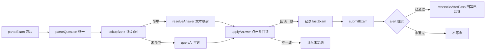

# 架构说明

面向需要改脚本的维护者：讲清楚多省份适配怎么做、页面长什么样、一道题从 DOM 到答案经历了什么、哪些设计是故意的。

主文件 `civil-servant-training-assistant.user.js` 单文件约 1.7k 行，内部用 `// ==================== 名称 ====================` 分段。本文用段名与函数名指代位置，不写行号。

## 1. 设计约束

| 约束 | 落地方式 |
| --- | --- |
| 单文件、无构建、无运行时依赖 | `package.json` 不声明 dependencies；工具链只用 Node 内置模块 |
| 体积可控 | 自检设 200 KB 预算，超出即失败 |
| 版本单一来源 | 用户脚本 `@version`；`package.json` 与 CHANGELOG 由检查脚本比对 |
| 不越权注入 | `@run-at document-idle`、`@noframes`、顶层窗口判定 |
| 平台改版可隔离 | 选择器集中在 `SEL`，题型常量集中在 `TYPE_TEXT` |
| 不伪造学时 | 播放只解除失焦暂停，不改上报的 `Location` / `Sessiontime` |
| 数据留在本地 | 题库、设置、上次作答记录都在油猴存储，无服务端 |

两条最容易踩的边界：**页面结构变化只改 `SEL`**；**答案以「交卷通过」为唯一验证依据**。

## 2. 多省份适配

各省「公务员网络培训」平台多为同一套系统的不同部署：试卷页的 `div.shiti > div.shiti_l`、答题卡、播放页的 `window.onblur` 反作弊，结构高度相似。差异集中在三处：**域名**、**播放器路径**、**外壳类名**。

适配信息集中在 `SITES` 数组，一项对应一个省份：

| 字段 | 用途 |
| --- | --- |
| `id` | 内部标识，用于日志与诊断 |
| `label` | 面板状态条显示的名字，如「甘肃省」 |
| `hosts` | 域名列表，支持子域匹配（`a.gwypx.gsdj.gov.cn` 命中 `gwypx.gsdj.gov.cn`） |
| `playerPath` | 播放页路径正则，决定 `isPlayerPage()` |
| `listPath` | 课程列表路径正则 |
| `sel` | 选择器集合，结构一致时直接引用 `BASE_SEL` |

### 域名解析

`resolveSite(hostname)` 是纯函数，按 `hosts` 精确匹配或后缀匹配：

```js
resolveSite('gwypx.gsdj.gov.cn')          // → 甘肃配置
resolveSite('a.gwypx.gsdj.gov.cn')        // → 甘肃配置（子域）
resolveSite('gwypx.gsdj.gov.cn.evil.com') // → null（后缀匹配不会误判）
```

**不做 `includes` 判断**。`'gwypx.gsdj.gov.cn.evil.com'.includes('gwypx.gsdj.gov.cn')` 为真，用 `includes` 会被伪装域名蹭上配置。

### 兜底与静默退出

- 域名命中 `SITES` → 用该省份配置，正常工作。
- 域名没命中，但页面 DOM 看得出是培训平台（有试卷 / 播放页 / 课程列表）→ 用 `FALLBACK_SITE`（`BASE_SEL` + 通用路径正则），状态条显示「通用适配」，日志给一条 warn。
- 两者都不成立 → `boot()` 直接 `return`，不建面板、不写存储。避免用户把 `@match` 放宽后，脚本在普通网页上也弹面板。

### 新增省份的步骤

1. 在 `SITES` 加一项，填 `hosts` 与 `label`；结构与甘肃一致就 `sel: BASE_SEL`
2. 结构不一致时，只覆盖不同的字段：

   ```js
   sel: { ...BASE_SEL, examForm: '#examForm', optionBox: '.opt-list' }
   ```

3. 脚本头补 `@match` 与 `@connect`（不补的话脚本根本不会注入）
4. 加一条 `resolveSite` 的断言到 `selfTest()`，防止域名写错
5. 在 `tests/fixtures/` 放一份该省份的试卷结构快照，`page-smoke.mjs` 里加一轮

第 7 步可选但值得做：同构平台的小差异（比如选项容器换个类名）往往只有真实页面才能暴露。

## 3. 代码分段

| 段 | 职责 | 关键函数 |
| --- | --- | --- |
| 元数据与配置 | 版本、权限、可调参数 | `VERSION`、`CONFIG` |
| 站点适配层 | 多省份配置、选择器、题型文案 | `SITES`、`BASE_SEL`、`resolveSite`、`SEL`、`TYPE_TEXT` |
| 通用工具 | 取值、日志、存储、延时 | `pick`、`textOf`、`log`、`store` |
| 内置种子题库 | 442 条 `[题型, 题干, 答案文本, 字母]` | `SEED_RAW`、`seedBank`、`mergeSeed` |
| 题库 | 归一化、指纹、相似检索、写库 | `pureStem`、`normStem`、`fpKey`、`lookupBank`、`saveEntry` |
| 试卷解析 | 分题型块、配对 dl/xuxiang、取选项 | `parseExam`、`parseQuestion` |
| 作答 | 答案映射、点击、回读校验、决策 | `resolveAnswer`、`clickOption`、`applyAnswer`、`decide` |
| 交卷与对账 | 表单提交、结果解析、答案回写 | `submitExam`、`hookSubmitAlert`、`reconcileAfterPass` |
| 考试流程 | 主循环、异常题型保护 | `runExam` |
| 播放解锁 | 失焦拦截、续播 | `playerGuard` |
| 面板 | Shadow DOM UI、胶囊开关、分组、拖动 | `createPanel`、`TOGGLES`、`syncToggles` |
| 导入导出 | JSON / CSV、公式消毒、下载 | `importData`、`exportCsv` |
| 自检与启动 | 纯函数断言、页面分流 | `selfTest`、`boot` |

分层原则：高层只依赖低层的纯函数。流程控制不碰选择器细节，对账不碰 DOM 颜色。这样 Node 自检才能只加载脚本就断言大部分判断逻辑。

## 4. 页面地图

### 4.1 试卷页 `/gradeExam/gradeExamInfo.do?courseId=&gradeId=`

服务端直出静态 HTML，结构如下（判断题多包了一层，是最容易解析错的地方）：

```
form#examInfoFrom
  input[hidden]  courseId / gradeId / testTime / jsTime
  div.shiti
    div.shiti_l                      ← 单选题块
      h2  一、单选题（共2道题…）
      dl.danxuan  +  div.xuxiang     ← 成对出现
      dl.danxuan  +  div.xuxiang
    div.shiti_l.shiti_2              ← 多选题块（dl 类名同样是 danxuan）
      h2  二、多选题…
      dl.danxuan  +  div.xuxiang
    div.shiti_l                      ← 判断题块
      h2  三、判断题…
      div.shiti_l                    ← 每题再包一层
        dl.danxuan + div.xuxiang
    div.shiti_r                      ← 右侧答题卡（不使用）
```

三个必须知道的坑：

1. **多选题的 `dl` 类名与单选相同**，都是 `danxuan`。题型只能按控件类型（`radio` / `checkbox`）判，再用 `name` 前缀 `panduan` 细分判断题。
2. **题号在每个题型块内从 1 重新开始**，不能当唯一键。唯一标识取 `name` 里的数字（`danxuan9163` → `9163`）。
3. **页头「全卷题数：10道题」是模板写死的**，实际每卷 5 题（单选 2 + 多选 1 + 判断 2，每题 20 分）。只按 DOM 统计，不信这句话。

选项文本取自 `dl` 下的 `dd`（带 `A.` 前缀，需剥掉）；判断题的 `dl` 没有 `dd`，文本从 `label` 取，控件 `value` 是 `1` / `0`，脚本统一改写成字母 `A` / `B` 便于导出。

### 4.2 播放页 `/gansu-spcrm/videoPlayGJ/...`

页面直链由 `common.js#BeginStudy` 拼出，11 段参数以 `/` 分隔，第 12 段是 `strEnc(token,'adks1'…)` 的签名串。页面自身：

```js
window.onblur = isLeaveOrEnter;   // 唯一一行反作弊
```

`isLeaveOrEnter()` 弹提示，2 秒后 `myJwPlayer.play(false)`。计时链路是 `getPlayTime()`（仅在 `state==='PLAYING'` 时累加墙钟）→ 每 10 秒 `doAjaxPost()` → `POST /gansu-spcrm/rest/AddCourse`。

### 4.3 课程列表

`/gradeCourse/getGradeCourseList.do`，分页参数是 `currentPage`（不是 `page`）。每门课 `BeginStudy(courseId, code, scorm, name)` 与 `examInfoDivShow(courseId, name, 100, 60, 10, 15)` 两个入口。脚本在此页只显示面板，不做批量操作。

## 5. 一道题的完整路径



设计取舍：

- **回读校验**：点完必须再读一次 `input.checked`，连续不一致就记未定，避免「以为点了」。
- **文本优先**：答案存选项文本，平台打乱顺序也不会错位；字母只作兜底。
- **宁缺勿错**：题库无答案且未开 AI 时跳过该题并记日志，不猜。

## 6. 题库模型

| 字段 | 含义 |
| --- | --- |
| `q` | 归一化题干（去题号、去「（20分）」、去标点） |
| `t` | `single` / `multi` / `judge` |
| `a` | 答案的选项文本数组（主数据） |
| `l` | 答案字母（辅助） |
| `src` | 来源：`seed` / `import` / `exam` / `user` |
| `ts` / `us` | 首次入库 / 最近使用时间 |
| `hit` / `ok` / `bad` | 命中 / 已验证答对 / 答错次数 |

主键 `fpKey`：对 `normStem` 做 FNV-1a 32 位哈希，附长度 base36，前缀 `#`。命中路径是「指纹精确 → 前缀桶 + 3-gram 相似度」，相似度需 ≥0.92 且第二名明显更低，否则视为有歧义、交回联网。

### 存储键

| 键（前缀 `gwx_`） | 内容 |
| --- | --- |
| `bank` | 题库字典 |
| `lastExam` | 本场作答记录，交卷对账用 |
| `seeded` | 是否已导入过内置题库 |
| `cfg_*` | 面板各开关与 AI 接口配置 |
| `panelPos` / `groups` | 面板位置与分组折叠状态 |

## 7. 反作弊机制与拦截点

| 平台提示 | 代码里的实现 | 脚本行为 |
| --- | --- | --- |
| 点击其它文件或页面 | `window.onblur` | 置空 + 捕获阶段拦截 |
| 其它软件遮挡页面 | **无** | 无需处理 |
| 同时打开多个播放页 | **无** | 不做并发引导 |

技术上，`AddCourse` 没有签名校验（对比：打开播放页的 `StudyKey` 是 MD5 签名，但 `common.js` 里的校验被注释掉了，`addressInit()` 只定义未调用）。一次上报一个很大的 `Sessiontime` 在技术上是通的。

**脚本不做这件事。** 原因写在 [README](../README.md) 的「边界」一节：解除失焦暂停是改善体验，伪造学时是骗取记录。

## 8. 扩展点

| 想改什么 | 先看哪里 | 必须同步什么 |
| --- | --- | --- |
| 页面选择器 | `SEL` | `tests/fixtures/exam-paper.html` + 页面冒烟断言 |
| 新增题型 | `parseQuestion`、`TYPE_TEXT`、`applyAnswer` | 自检用例、`runExam` 的异常题型保护 |
| 换 AI 服务 | `CONFIG.aiUrl`、`queryAI` | 脚本头 `@connect`、`docs/DEVELOPMENT.md` 的说明 |
| 新设置项 | `CONFIG`、面板模板 | `loadConfig` 的键名、存储键表 |
| 改对账规则 | `hookSubmitAlert`、`reconcileAfterPass` | 自检用例 |

改判断逻辑时优先写成纯函数并加进 `selfTest()`：Node 自检与浏览器内自检跑的是同一批用例，回归成本最低。
